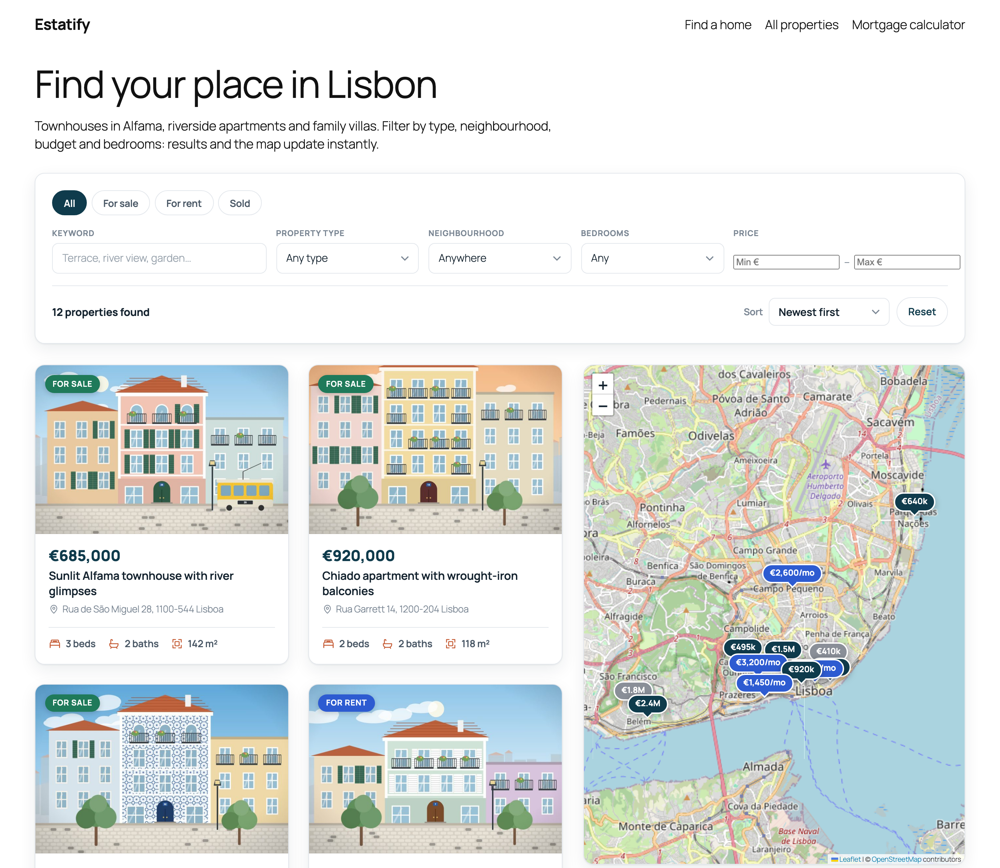
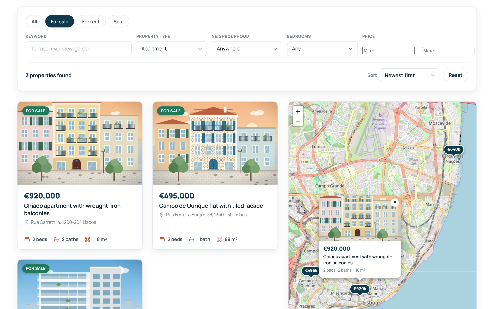
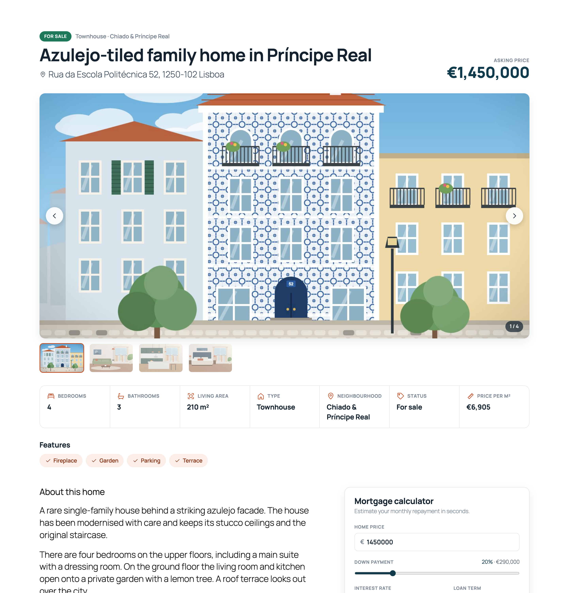
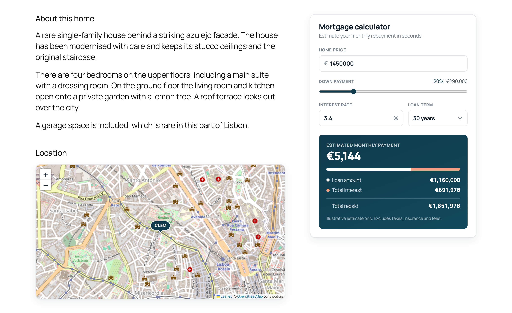
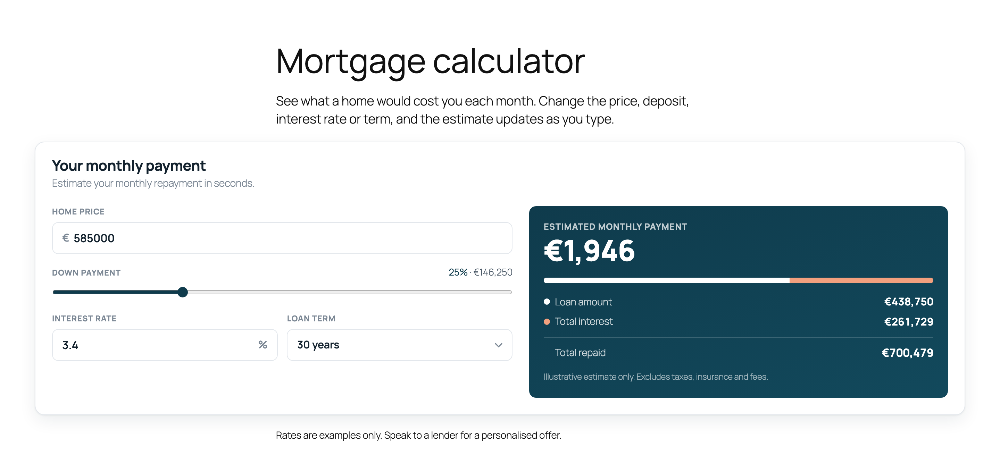
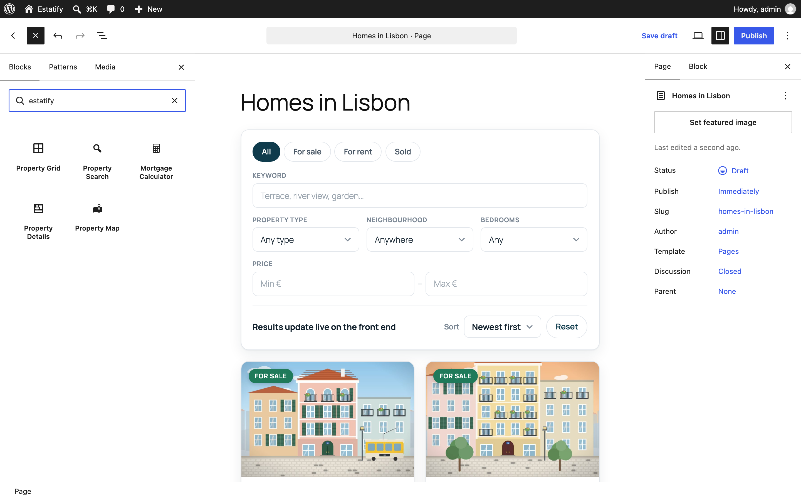
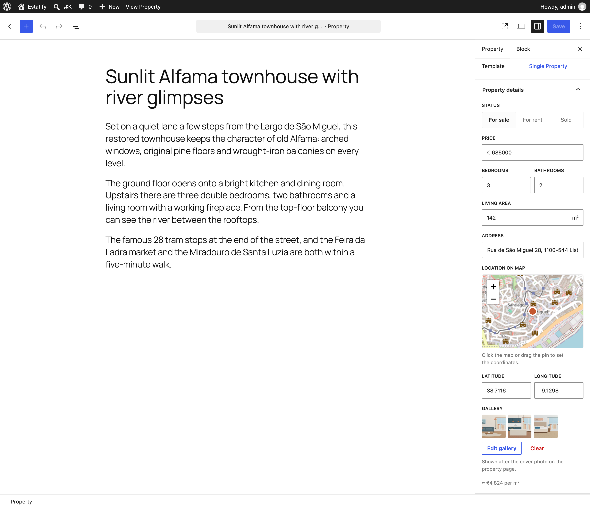
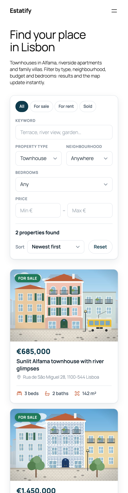
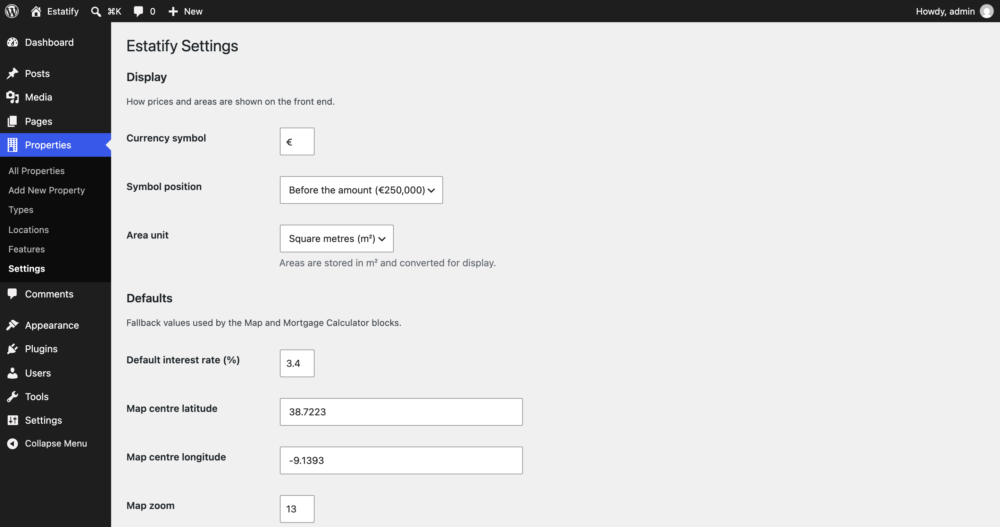

# Estatify: real-estate listings for WordPress

A custom WordPress plugin that adds property listings to any block theme. It includes a custom post type with typed meta, a filterable REST API and five Gutenberg blocks built with React and the Interactivity API: live search, a listing grid, a Leaflet map, a mortgage calculator and a property details view.

> **Demo / portfolio project.** I built Estatify to show how I approach custom plugin, block and REST API work. The listings, addresses, prices and photos are fictional. The photos are illustrations generated by a script in this repo.

[](https://playground.wordpress.net/?blueprint-url=https://raw.githubusercontent.com/yusufdeveloper2903/estatify-real-estate/main/blueprint-github.json)

**▶ [Open the live demo in WordPress Playground](https://playground.wordpress.net/?blueprint-url=https://raw.githubusercontent.com/yusufdeveloper2903/estatify-real-estate/main/blueprint-github.json)**: a complete WordPress site with 12 Lisbon listings runs in your browser. Nothing to install, and you are logged in as admin.



## Features

**Content model**
- `property` post type with **Type**, **Location** and **Feature** taxonomies.
- Registered, typed and sanitized post meta exposed in the REST API: price, bedrooms, bathrooms, area (m²), address, latitude/longitude, status (`for_sale`, `for_rent`, `sold`) and a photo gallery.
- A **"Property details" panel in the block-editor sidebar** (`PluginDocumentSettingPanel`, React). Its click-to-place Leaflet location picker and gallery picker save through core-data. There are no classic meta boxes.

**REST API**
- `GET /wp-json/estatify/v1/properties` filters by type, location, feature, status, price range, bedrooms, bathrooms and keyword, with sorting and pagination.
- Every argument has a schema (types, enums, min/max) and a sanitizer, so WordPress rejects invalid requests with `400` before the callback runs.
- A permission callback only exposes published listings and applies a light rate limit to anonymous clients.

**Blocks** (`@wordpress/scripts`, `block.json` apiVersion 3, all dynamic with PHP render)
| Block | What it does |
| --- | --- |
| **Property Search** | Status tabs, keyword, type, neighbourhood, bedrooms, price range and sort. It queries the REST endpoint and updates the grid and map **without a page reload** (Interactivity API), and keeps the URL query string in sync, so `/?ptype=apartment&beds=2` is shareable and renders on the server. Without JS it falls back to a plain GET form. |
| **Property Grid** | Cards with photo, status badge, price, beds, baths and area. Inspector controls set columns, listings per page, pagination, default order, and fixed filters when the grid isn't connected to a search. |
| **Property Map** | Leaflet with OpenStreetMap tiles and price-pin markers with popups. It follows the search filters, or shows only the current listing on a property page. |
| **Mortgage Calculator** | Interactive monthly payment, loan amount, interest and total cost. Defaults (price, deposit %, rate, term) are editable in the inspector, and on property pages it starts from the listing price. |
| **Property Details** | Title, price, gallery with thumbnails and keyboard navigation, spec table (beds, baths, area, type, neighbourhood, status, price per m²) and feature chips. |

**Theme integration and admin**
- Block templates (`single-property`, `archive-property` and the taxonomy archives) registered with `register_block_template()`. They use the active block theme's header and footer, are tested with **Twenty Twenty-Five**, and can be customised in the Site Editor.
- **Properties → Settings** page built on the Settings API: currency symbol and position, area unit (m²/ft², converted for display) and map and mortgage defaults.
- WP-CLI commands: `wp estatify seed` imports the demo content, and `wp estatify list --status=for_sale` lists listings.

**Code quality**
- PHP 8 with strict types, `Estatify\` namespaces and a small PSR-4 autoloader. Input is sanitized and output is escaped everywhere.
- i18n-ready: PHP, JS and templates use the `estatify` text domain, and `languages/estatify.pot` is included.
- No jQuery. The front end uses about 3 KB of Interactivity API modules, plus Leaflet only on pages with a map.
- One data shape (`Presenter::card()`) feeds the server render, the REST API and the client-side updates, so they cannot drift apart.

## Screenshots

| | |
| --- | --- |
|  Live filters, map popup |  Single property template |
|  Location map and calculator on a listing |  Mortgage Calculator block |
|  The five Estatify blocks in the inserter |  Property details sidebar panel |
|  Mobile |  Settings page |

## Run it locally

You need Node 20+. PHP, MySQL and Docker are not required, because WordPress runs in [WordPress Playground](https://wordpress.github.io/wordpress-playground/) (PHP compiled to WebAssembly, with SQLite).

```bash
git clone https://github.com/yusufdeveloper2903/estatify-real-estate.git
cd estatify-real-estate
npm install
npm run dev        # http://127.0.0.1:9403, logged in as admin
```

`npm run dev` mounts this folder as `wp-content/plugins/estatify` and runs [`blueprint.json`](blueprint.json). The blueprint activates Twenty Twenty-Five and the plugin, then imports the demo content: 12 listings with meta, terms, coordinates and bundled photos, a **Find a home** front page with the Search, Map and Grid blocks, a **Mortgage calculator** page and a menu. Each start is a fresh site.

> **No build step needed.** The compiled `build/` folder is committed, so you can copy the plugin into any WordPress 6.7+ site and activate it. Run `npm run build` (or `npm start` to watch) only if you change files in `src/`.

| Script | Purpose |
| --- | --- |
| `npm run build` / `npm start` | Production build / watch mode (`wp-scripts`, ES-module view scripts, blocks manifest) |
| `npm run dev` | Playground on port 9403 with the plugin mounted and the local blueprint |
| `npm run test:smoke` | Playwright end-to-end checks against the running site (25 checks: live filtering, URL sync, map, templates, calculator, block validity, sidebar save, REST validation, no PHP notices or JS errors) |
| `npm run screenshots` | Regenerates `docs/screenshots/*.png` |
| `npm run images` | Regenerates the illustrated demo photos in `demo/images/` |
| `npm run i18n:pot` | Regenerates `languages/estatify.pot` with WP-CLI inside Playground |
| `npm run plugin-zip` | Builds an installable `estatify.zip` |

There are two blueprints. `blueprint.json` expects the plugin to be mounted locally. [`blueprint-github.json`](blueprint-github.json) installs the plugin from this repository's `main` branch with a `git:directory` resource, which is what powers the live demo link.

## REST API

### `GET /wp-json/estatify/v1/properties`

| Param | Type | Default | Notes |
| --- | --- | --- | --- |
| `search` | string | | Keyword search in title and content (max 100 chars) |
| `type` | slug(s) | | Property type, comma-separated for several (`apartment,loft`) |
| `location` | slug(s) | | Location term slug(s) |
| `feature` | slug(s) | | Listings must have **all** of the given features |
| `status` | enum | | `for_sale`, `for_rent`, `sold` |
| `min_price` / `max_price` | integer ≥ 0 | | Price range (monthly rent for rentals) |
| `beds` / `baths` | integer 0–20 | | Minimum bedrooms / bathrooms |
| `orderby` | enum | `date` | `date`, `title`, `price`, `area`, `bedrooms` |
| `order` | enum | `desc` | `asc`, `desc` |
| `page` | integer ≥ 1 | `1` | |
| `per_page` | integer 1–50 | `9` | |
| `with_markers` | boolean | `false` | Also return lightweight map markers for **all** matches |

Example:

```bash
curl "https://example.com/wp-json/estatify/v1/properties?type=apartment&status=for_sale&max_price=700000&orderby=price&order=asc"
```

```jsonc
{
  "items": [
    {
      "id": 18,
      "title": "Campo de Ourique flat with tiled facade",
      "link": "https://example.com/property/campo-de-ourique-flat-with-tiled-facade/",
      "image": "https://example.com/wp-content/uploads/…/campo-de-ourique-flat-768x512.jpg",
      "price": 495000,
      "priceFormatted": "€495,000",
      "status": "for_sale",
      "statusLabel": "For sale",
      "bedrooms": 2, "bathrooms": 1, "area": 88, "areaFormatted": "88 m²",
      "address": "Rua Ferreira Borges 33, 1350-130 Lisboa",
      "lat": 38.7179, "lng": -9.1662,
      "type": "Apartment", "location": "Estrela & Campo de Ourique",
      "features": [ "Balcony", "Renovated" ]
    }
  ],
  "total": 2,
  "total_pages": 1,
  "page": 1,
  "per_page": 9
}
```

The response also sets `X-WP-Total` and `X-WP-TotalPages` headers. Invalid input such as `status=haunted` or `per_page=500` returns `400 rest_invalid_param`.

### `GET /wp-json/estatify/v1/properties/<id>`

Returns a single published listing in the same shape, or `404` if it doesn't exist.

The core endpoint `/wp/v2/properties` also exposes the raw meta (`_estatify_price`, …) to authenticated editors. The block-editor sidebar uses it to save.

## Code structure

```
estatify.php                  Plugin header, constants, autoloader, bootstrap
includes/
  Plugin.php                  Wires components to hooks; activation/deactivation
  PostTypes/PropertyPostType  CPT + taxonomies
  Meta/PropertyMeta           register_post_meta() with schemas, sanitizers, auth
  Rest/PropertiesController   estatify/v1/properties: args, permissions, schema
  Support/PropertyQuery       Normalizes filters → WP_Query (shared by REST + blocks)
  Support/Presenter           One listing shape for REST, SSR and Interactivity state
  Support/{Format,Settings,Mortgage,Icons}
  Blocks/Blocks               Registers blocks from build/blocks-manifest.php, editor assets
  Blocks/SearchState          Reads URL filters, seeds the Interactivity API store
  Blocks/Templates            register_block_template() for single/archive/taxonomy
  Admin/SettingsPage          Settings API page
  CLI/Command                 wp estatify seed | list
  Demo/Seeder                 Demo importer used by the blueprints
src/
  blocks/<block>/             block.json, edit.js (React), render.php, view.js, style.scss
  editor/index.js             PluginDocumentSettingPanel for property meta
  shared/store.js             Interactivity API store: filters, fetch, URL sync, pagination
  shared/leaflet-map.js       Leaflet wrapper used by the view module and the editor
build/                        Compiled assets (committed)
templates/                    Block template markup (PHP for i18n)
demo/listings.json, images/   Fictional demo data and generated illustrations
tools/                        Playwright smoke test, screenshots, image generator
blueprint.json                Local Playground blueprint (plugin mounted)
blueprint-github.json         Remote blueprint (installs from GitHub)
```

## How the live search works

1. `render.php` of the Search, Grid and Map blocks calls `SearchState::bootstrap()`. It reads the URL filters (`?ptype=…&loc=…`), runs the first query on the server and seeds the `estatify` Interactivity API store, so the first paint is complete HTML.
2. The grid renders its cards from a single `<template data-wp-each>`. WordPress processes it on the server for the initial HTML, and the client uses the same markup for updates.
3. When a filter changes, `actions.fetchResults()` calls the REST endpoint (aborting any request still in flight, and debouncing typed input), replaces `state.results` and `state.markers`, and calls `history.replaceState()` to update the URL. The grid re-renders, and the map's `data-wp-watch` callback redraws the pins.

## Requirements

WordPress 6.7+ (tested on 7.1) and PHP 8.0+ (tested on 8.3). Use it with a block theme to get the templates. The blocks work in any theme.

## License

[GPL-2.0-or-later](LICENSE). © 2026 Yusuf Yuldashev. Bundles [Leaflet](https://leafletjs.com) (BSD-2-Clause). Map tiles © [OpenStreetMap](https://www.openstreetmap.org/copyright) contributors.
